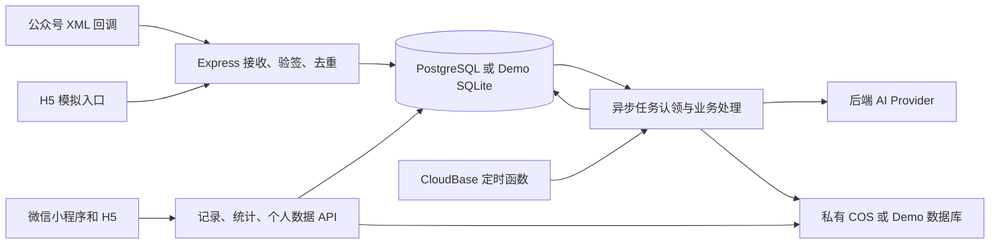

# LifeLog AI 系统架构

## 项目结构

| 位置 | 职责 |
| --- | --- |
| `apps/web` | uni-app、Vue 3、TypeScript 和 Pinia。四个主页面共用 API 客户端和记录表单，编译为 H5 与微信小程序。 |
| `apps/server/src` | Express API、鉴权、身份绑定、数据库适配、记录与统计、异步任务。 |
| `apps/server/src/intake` | 微信 XML 协议、结构校验、文字与多模态解析、营养参考数据及媒体接入。 |
| `apps/server/migrations` | SQLite 与 PostgreSQL 共用的版本化 SQL 迁移。 |
| `apps/server/test` | 解析、业务与 HTTP 接口自动化验证。 |
| `cloudfunctions/lifelog-tick` | CloudBase 定时函数，凭独立密钥唤醒同一服务。 |
| `Dockerfile` 与 `scripts/stage-cloudbase.mjs` | 生产容器构建与上传内容白名单。 |

## 消息流和幂等

1. 公众号回调校验签名，按配置解析 XML 或解密正文，保留原始消息字段和接收时间。模拟入口直接提交相同业务消息结构。
2. 消息用渠道、发送人和消息 ID 组合去重。原始消息落库并进入异步处理，微信回执与 AI 调用分开。未绑定的消息保留在待关联状态，绑定成功后仅领取该公众号发送人的消息。
3. 任务认领使用数据库状态和有期限的租约。工作进程重启后，可回收过期认领；失败保留有限重试和可查询的错误状态。任务完成与记录落库同一事务，每条原始消息的记录序号有唯一约束。一条消息可拆为多个业务记录。
4. 业务记录统一有标题、内容、事件日期、用户时区、确认状态和原消息引用。不同类型使用各自结构化数据。日期上下文以消息接收时间和用户时区为基准，创建时间、提醒等绝对时间以 ISO 8601 UTC 保存。

## 存储与隔离

- 生产数据库使用 PostgreSQL，CloudBase 内使用独立 `lifelog` schema 和业务角色。客户端经应用 API 获取数据。应用从会话确定内部用户 ID，记录、任务、媒体、导出均通过所有者边界访问。
- 本地 SQLite 使用相同迁移和业务 SQL。SQLite 写事务与 PostgreSQL 写事务分别使用本地串行处理和数据库事务锁；模型、媒体网络操作在事务之外执行。
- `users`、`account_links`、`sessions` 和 `bind_codes` 管理内部身份、渠道关联与凭证。会话和绑定码以散列形式存储。短期绑定码有单次使用约束及发送人尝试限制。
- `raw_messages`、`ai_jobs`、`media` 保存输入及任务状态。`records` 保存四类业务数据，饮食项、训练动作与每组数据及待办属性放在按类型校验的 JSON 中，按用户、类型与事件日期索引。`nutrition_goals` 与 `daily_summaries` 分别保存目标和待办摘要。
- 生产媒体文件存入私有 COS，文件由已鉴权接口读取，用户数据删除会撤回访问并清理相关对象。COS 生命周期负责兜底清理过期对象。开发模式的图片随 SQLite 数据保存。

## 业务计算

- AI Provider 与业务写入分离。远程模型配置在服务端，输出经过结构校验和边界检查。开发用的本地规则可按原文识别常见输入，来源在 UI 和任务状态中区分。
- 营养服务使用 USDA FoodData Central SR Legacy 每 100 g 可食部参考值，按食物条目和重量换算。无法可靠匹配的烹饪方式、未知份量或混合食物保留缺失。照片份量为估计值，用户可修订营养条目。[FoodData Central 数据说明](https://fdc.nal.usda.gov/data-documentation.html)
- 训练总容量按各有重量、次数的训练组累加。运动能量按体重、时长及 MET 估算，必要信息不足时保留空值。
- 统计从数据库中现存业务记录汇总。待办支持完成和重复实例，日历导出采用 iCalendar。待办摘要按用户时区归日，微信通知范围见 [权限边界](PERMISSIONS.md)。
